# E-Commerce Analytics Lakehouse (Databricks)

A medallion (bronze → silver → gold) pipeline on **Databricks** that turns six messy raw
e-commerce sources into a clean **star schema** in **Delta Lake** on **Unity Catalog**, and feeds a
**Tableau** dashboard.

Built with PySpark and Spark SQL on Databricks Free Edition (serverless).

**[View the live dashboard on Tableau Public](https://public.tableau.com/views/ecommerce_sales_17930491835610/E-CommerceSalesDashboard)**

<!-- screenshot: docs/dashboard.png -->

---

## Architecture

```mermaid
flowchart LR
    subgraph RAW["Unity Catalog volume  /Volumes/ecommerce/source_data/raw"]
        R1[brands] & R2[category] & R3[products] & R4[customers] & R5[date] & R6[order_items]
    end
    subgraph BRONZE["bronze  (as received + lineage)"]
        B1[brz_brands] & B2[brz_category] & B3[brz_products] & B4[brz_customers] & B5[brz_dates] & B6[brz_order_items]
    end
    subgraph SILVER["silver  (cleaned, typed, de-duplicated)"]
        S1[slv_brands] & S2[slv_category] & S3[slv_products] & S4[slv_customers] & S5[slv_dates] & S6[slv_order_items]
    end
    subgraph GOLD["gold  (star schema)"]
        D1[gld_dim_products] & D2[gld_dim_customers] & D3[gld_dim_date] --> FACT[gld_fact_order_items]
    end
    RAW --> BRONZE --> SILVER --> GOLD --> CSV[sales_report.csv] --> TAB[Tableau Public]
```



### Star schema

| Table | Grain | Built from |
|---|---|---|
| `gld_fact_order_items` | one order line | order items + gross, discount, net amounts + INR conversion + coupon flag |
| `gld_dim_products` | product | products + brand name + category name |
| `gld_dim_customers` | customer | customers + sales region (country/state mapping) |
| `gld_dim_date` | day | calendar + `date_id`, month name, weekend flag |

## What the raw data looks like, and how silver fixes it

| Source | Problem in the raw files | Silver rule |
|---|---|---|
| order items | quantity as text (`"Two"`), prices with `$`, discounts with `%`, two timestamp formats, `web`/`app` channel codes, duplicate lines | map/strip/cast; `coalesce` of two timestamp patterns; channel names; de-dup on `(order_id, item_seq)` |
| products | weights like `"450g"`, lengths with comma decimals (`"12,5"`), material typos (`Coton`, `Alumium`, `Ruber`), negative rating counts | strip/replace/cast, typo fixes, `abs()` |
| brands | stray spaces, special characters in codes, catalog codes in two spellings (`GROCERY` vs `GRCY`) | `trim`, regex clean, code mapping |
| category / dates | duplicate keys, negative week numbers, lower-case day names | de-dup, `abs()`, `initcap()` |
| customers | missing ids, missing phone numbers | drop rows without an id, fill phone |

Bronze reads every file with an **explicit schema** and adds source-file and ingest-time lineage columns.

### Bugs found and fixed

- **Brand codes never cleaned:** the catalog-code mapping was assigned to a new variable, but the
  table was written from the old one, so `slv_brands` still had both spellings. Fixed by writing the mapped DataFrame.
- **Wrong product categories:** `gld_dim_products` took each product's category from its *brand's*
  catalog code instead of the product's own `category_code`. Now brand and category are joined
  separately on the product's own keys, and **100% of products resolve to a category**.
- **Misspelled CSV option** (`delimeter`), which Spark silently ignored.

## Tableau dashboard

`reporting/4_tableau_export.py` joins the fact table to its dimensions (broadcast joins on the
small dimension tables) and writes one CSV to a Unity Catalog volume, since Tableau Public can't
connect to Databricks directly. The dashboard has:

- KPI cards: total revenue, orders, average order value
- daily revenue trend, revenue by category, by country, and Mobile vs Website
- a country filter that updates every chart

The raw prices are in 7 currencies, so revenue uses the fact table's INR amount converted to USD
(88.29 INR per USD, the same rate as the gold notebook).
`tableau/make_extract.py` and `tableau/build_workbook.py` rebuild the Tableau extract and workbook from the CSV.

## Results

| Metric | Value |
|---|---|
| Order lines in the fact table | 183,378 |
| Orders | 104,756 |
| Customers / countries / categories | 88,495 / 7 / 8 |
| Date range | Aug 1 – Oct 31, 2025 |
| Revenue (converted to USD) | $38.6M |
| Average order value | $368 |
| Products with a resolved category | 100% |

## How to run

1. **Import** this repo into Databricks (Workspace → Create → **Git folder**, or Import a ZIP).
2. **Upload the raw CSVs** to `/Volumes/ecommerce/source_data/raw/` in the folders
   `brands/`, `category/`, `products/`, `customers/`, `date/`, `order_items/`.
3. **Run the notebooks in order:**
   `setup/setup` → `1_dim_bronze` → `1_dim-silver` → `1_dim-gold` →
   `1_fact_bronze` → `2_fact_silver` → `3_fact_gold` → `reporting/4_tableau_export`
4. **Download** `sales_report.csv` from Catalog → ecommerce → source_data → exports and open it in Tableau.

## Project structure

```
├── setup/setup.py                          # catalog and schemas
├── medallion_processing_dim/
│   ├── 1_dim_bronze.py                     # 5 dimension sources -> bronze Delta tables
│   ├── 1_dim-silver.py                     # cleaning rules for dimensions
│   └── 1_dim-gold.py                       # dim_products, dim_customers (+region), dim_date
├── medallion_processing_fact/
│   ├── 1_fact_bronze.py                    # order items -> bronze
│   ├── 2_fact_silver.py                    # cleaning + typing for order items
│   └── 3_fact_gold.py                      # fact table, amounts, INR conversion
├── reporting/4_tableau_export.py           # gold star schema -> one CSV for Tableau
└── tableau/                                # rebuild the Tableau extract + workbook from the CSV
```

## Data

_Source: add where the raw CSV files came from._ The raw files are not stored in this repository.

## Next steps

- Data quality checks (unique keys, valid amounts, orphan keys) that fail the run on errors
- A Databricks Job to run the notebooks in dependency order
- Incremental loads with **Auto Loader** and `MERGE INTO` instead of full overwrites
